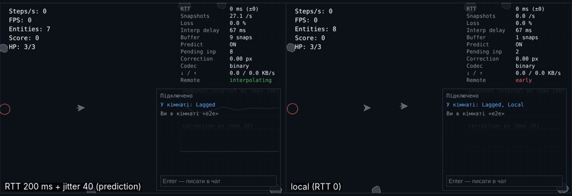
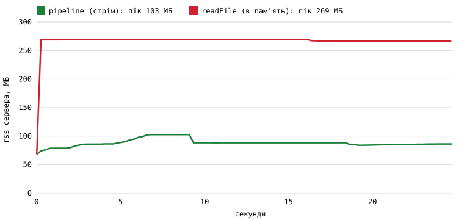
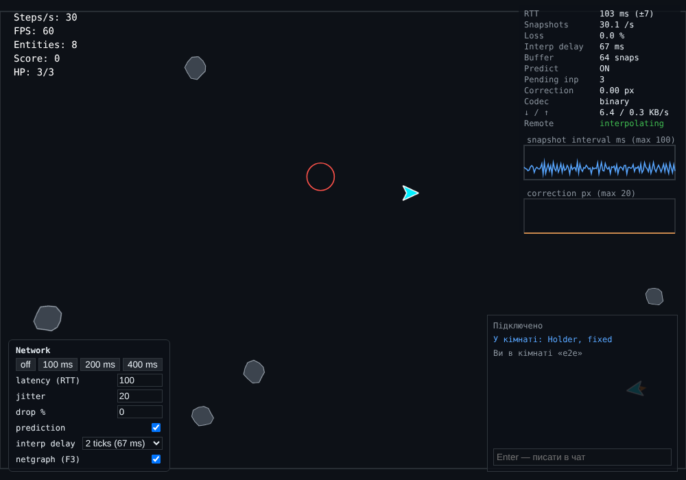
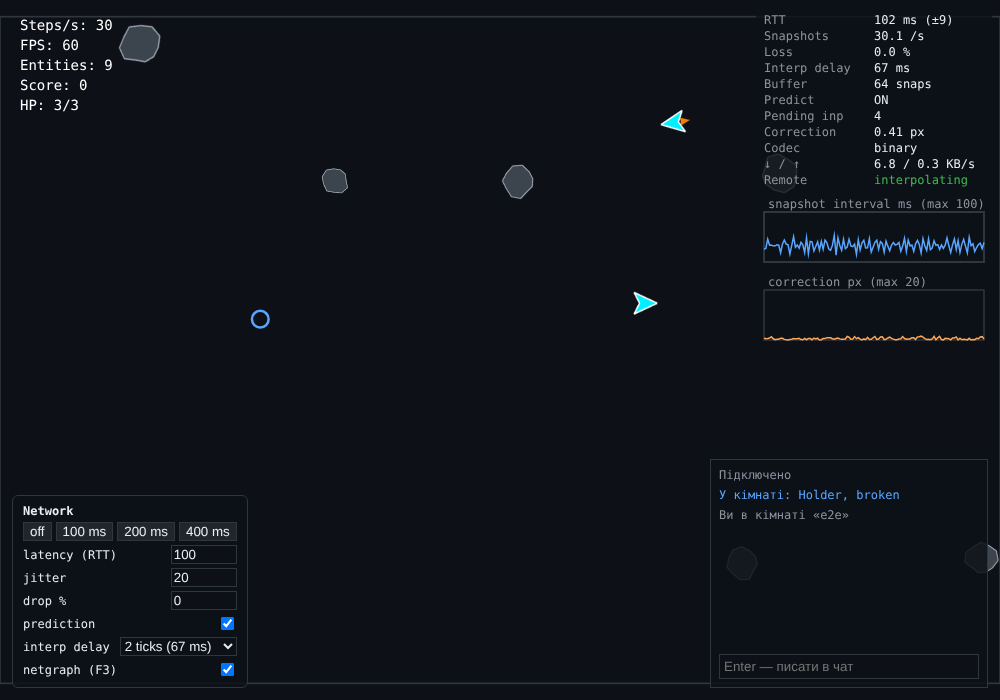

# Dogfight — Labs 01–06



*Два клієнти в одній кімнаті: ліворуч — з імітацією RTT 200 мс ± 40 мс, праворуч — без затримки. Власний корабель відгукується одразу (передбачення), чужі плавні (інтерполяція).*

Мультиплеєрна арена: клієнт на Canvas (Labs 01–03), сервер на Node.js з кімнатами, чатом і логами матчів (Lab 04), авторитетний сервер з передбаченням, реконсиляцією та інтерполяцією на клієнті (Lab 05), **увесь код — на суворому TypeScript (Lab 06)**. Репозиторій — npm workspaces: `shared/`, `client/`, `server/`.

## Запуск

```bash
nvm use                  # Node 22 (.nvmrc)
npm install              # ставить усі workspace-и (shared + client + server)
cp server/.env.example server/.env    # за потреби змінити порт/ліміти

npm run dev:server       # Node-сервер: http://127.0.0.1:3000
npm run dev:client       # Vite: http://localhost:5173 (проксі /api і /ws на :3000)

npm run build && npm start   # production: Node віддає зібраний client/dist
npm run typecheck        # tsc --noEmit у shared, server, client (strict)
npm test                 # shared 47 + client 34 + server 84 тестів (node:test, запускаються як .ts)
npm run lint             # Biome
```

Для гри відкрийте два вікна на `http://localhost:5173`, у кожному клікніть по екрану, в одному створіть кімнату (**CREATE ROOM**), в обох натисніть **JOIN**. `Enter` — писати в чат.

Керування: `W/↑` — тяга, `A/D` або `←/→` — поворот, `Space` або клік по полю — постріл, `H` — самонавідна куля. `/?sequential` — завантажувати ассети по черзі (Lab 03).

Сервер і тести запускаються напряму з `.ts` (Node ≥ 22.6, `--experimental-strip-types`: прапорець уже прописано в скриптах `package.json`), клієнт збирає Vite; компілятор `tsc` лише перевіряє типи (`noEmit`).

Параметри мережі (Lab 05): `?netgraph=1` (також `F3`), `?latency=200&jitter=40&drop=2` (імітація для цього з'єднання), `?predict=0` (без передбачення), `?brokenIntegrate=1` (клієнтський integrate з `Math.random`), `?codec=json`, `?delay=2` (затримка інтерполяції в тиках). Те саме можна змінювати в панелі внизу ліворуч.

Скрипти-експерименти:

```bash
node client/scripts/failure-gallery.mjs     # Lab 03: галерея збоїв, sequential vs concurrent
node client/scripts/puzzles.mjs             # Lab 03: головоломки порядку виконання
node server/scripts/rss-experiment.mjs      # Lab 04: rss під повільним завантаженням (~1 хв)
node server/scripts/eventloop-demo.mjs      # Lab 04: блокування циклу подій
node server/scripts/crash-demo.mjs          # Lab 04: краш без "error"-слухача і його виправлення
node server/scripts/backpressure-loop.mjs   # Lab 04: pipeline проти ігнорування write()
node shared/scripts/codec-bench.mjs         # Lab 05: JSON проти бінарного протоколу
node shared/scripts/prove-it.mjs            # Lab 05: endianness, таймери, детермінізм
node shared/scripts/determinism-browser.mjs # Lab 05: хеш світу Node == Chromium (потрібні playwright, esbuild)
node --experimental-strip-types shared/scripts/ts-prove-it.mjs  # Lab 06: що TypeScript робить у рантаймі
```

## Структура

```text
shared/                  код, спільний для клієнта й сервера (Lab 05; типи й zod-схеми — Lab 06)
  src/sim/               детермінована симуляція: integrate, World, сутності, dmath
  src/types.ts           брендовані EntityId/PlayerId, assertNever
  src/emitter.ts         типізований Emitter<Events>
  src/protocol/          zod-схеми = єдине джерело правди; типи виводяться (z.infer)
  src/codec/             binary.ts (DataView) і json.ts — один інтерфейс
  src/netcode/           Predictor, SnapshotBuffer, ServerClock
  test/ scripts/         47 тестів; бенчмарк кодека, prove-it
client/                  Vite-застосунок (Labs 01–03 + мережа Lab 04–05)
  src/game/netgame.ts    передбачення + інтерполяція + події + статистика
  src/ui/netgraph.ts     netgraph; netPanel.ts — панель latency/jitter/drop
  src/main.ts            завантаження -> лобі -> гра -> підключення до кімнати
  src/loop.ts input.ts   фіксований крок, замикання для клавіатури
  src/render/ audio/     canvas, інтерполяція, спрайти, звук
  src/assets/loader.ts   fetchJson, withRetry, loadAll
  src/lobby/             Lobby (EventTarget) + lobbyView; тепер працює з /api/rooms
  src/net/               protocol.ts, connection.ts (черга send + reconnect)
  src/ui/chatView.ts     склад кімнати й чат
  vite.config.ts         проксі /api і /ws на Node-сервер
server/
  src/index.ts           запуск, graceful shutdown, фатальні помилки
  src/config.ts          PORT, HOST, LOG_DIR... з env, валідація
  src/app.ts             node:http: API, статика, стрімінг реплеїв
  src/static.ts          MIME, захист від path traversal
  src/rooms.ts           Room extends EventEmitter, RoomManager
  src/match.ts ticker.ts авторитетний світ кімнати, фіксований 30 Гц такт
  src/netsim.ts          імітатор latency/jitter/втрат для з'єднання
  src/ws.ts              життєвий цикл сокета, heartbeat, rate limit, slow-client
  src/ratelimit.ts       token bucket
  src/log/matchlog.ts    Transform: події -> NDJSON -> файл (pipeline)
  src/log/replay.ts      async-генератор над NDJSON-файлом
  test/                  82 тести, scripts/ — відтворювані експерименти
docs/                    rss-backpressure.svg / .csv
```

---

# Lab 01 — The Event Loop Is the Game Loop

## Архітектура

* Vite (Vanilla JS, ES Modules), Biome, `.nvmrc` (Node 22).
* `createLoop({ step, simulate, render })` — `requestAnimationFrame` + акумулятор часу із затисненням кадру `maxFrame = 0.25 с` (захист від «spiral of death»). Симуляція завжди йде кроком `1/60 с`, а рендер отримує `alpha = acc / step` для інтерполяції між попереднім і поточним станом (`prevPos`/`prevAngle`, кут інтерполюється найкоротшою дугою — `lerpAngle`).
* HUD показує steps/s, FPS і тривалість кадру. Steps/s тримається на 60 при будь-якій частоті дисплея (перевірено тестом на 30/60/144/240 Гц).
* Canvas враховує `devicePixelRatio`; трансформація виставляється на початку кожного кадру (`beginFrame`), бо зміна розміру canvas скидає стан контексту.
* Після wrap (телепорту через край арени) `prev`-стан зсувається, щоб інтерполяція не малювала смугу через усю арену.

## Експеримент 1: блокуючий цикл (100 ms busy-wait)

* Умови: синхронний цикл `while (performance.now() < t + 100)` раз на 60 кадрів у `render()`.
* Результат: звичайний стан `FPS ~144`, `Frame ~0.1 ms`; під час блокування FPS падає до 9–10, `Frame` стрибає до 101–105 ms.
* **Пояснення:** JavaScript виконується в одному потоці за принципом run-to-completion. Синхронний цикл тримає Call Stack; доки він не спорожніє, браузер не може перейти до кроку рендерингу (Style → Layout → Paint). Уникнути цього з того самого потоку неможливо — лише винести важку роботу у Worker або розбити на частини.

## Експеримент 2: `setInterval(frame, 16)` замість rAF

* В активній вкладці FPS коливається 58–63 (замість 144), джиттер часу кадру 8–24 ms. У фоновій вкладці (через 5 с) FPS падає до ~1, інтервал виростає до 1000 мс і більше.
* **Пояснення:** `setInterval` ставить задачі в чергу макрозадач без прив'язки до VSync, а неактивні вкладки браузер тротлить. `requestAnimationFrame` — це фаза циклу рендерингу: синхронізований із дисплеєм і автоматично паузиться у фоні.

## Експеримент 3: змінний крок (без акумулятора)

* Умови: `simulate(dt)` викликається напряму з часом кадру, утримується `W` 5 секунд.
* Без обмеження CPU (144 Гц): `x ≈ 542.3 px`. З CPU 6× slowdown: `x ≈ 511.8 px` (розбіжність > 30 px). З фіксованим кроком (60 SPS): `x = 538.6 px` в обох випадках.
* **Пояснення:** явний метод Ейлера зі змінним `dt` накопичує різну похибку залежно від частоти кадрів. Фіксований крок робить симуляцію детермінованою на будь-якому залізі — це ж основа для мультиплеєра (однакові входи → однаковий стан). Детермінізм перевіряє тест `детермінізм: однакові вхідні дані -> однаковий стан`.

---

# Lab 02 — Objects, Prototypes, and `this`: The Entity Model

## Модель

* `Vector2` — незмінний клас (кожен метод повертає новий вектор).
* `Entity` — `id` (приватний статичний лічильник), `pos`, `vel`, `angle`, `radius`, `alive`, `kind`, `behaviors`.
* Не більше одного рівня наслідування: `Ship`, `Bullet`, `Asteroid`, `Pickup`, `Explosion` `extends Entity`.
* `Ship` має приватне `#hp` із публічним getter; запис `ship.hp = 100` кидає `TypeError` (є тест). Смерть → вибух із частинок → респавн через 2 с у безпечному місці (`world.findSafeSpot`) з 1.5 с невразливості. Рахунок — у HUD.
* `World` тримає приватну `Map<id, Entity>`, ітерується через `for...of`, має генератор `*ofKind(kind)`. `despawn` лише позначає сутність, прибирає її фаза sweep наприкінці `step`.
* Зіткнення — окрема система `findCollisions(world)`, яка лише **генерує пари**; `resolvePair` розв'язує їх за таблицею `"kindA|kindB"`. Систему можна замінити через `new World({ collisions })` (є тест), наприклад на просторовий хеш.

## Баг із `this` і три виправлення

`window.addEventListener("click", ship.fire)` передає лише посилання на функцію. Браузер викликає її без об'єкта, тож спрацьовує *default binding*: в ES-модулях (strict mode) `this === undefined` і `ship.fire` падає з `TypeError`. Те саме станеться з `setTimeout(ship.fire, 100)`.

Правила `this` за пріоритетом: `new` → явне (`call`/`apply`/`bind`) → неявне (`obj.f()`) → default. Стрілки беруть `this` лексично й ігнорують `bind`.

1. **Стрілка-обгортка (обрано):** `window.addEventListener("click", () => ship.fire(world))`.
   + Просто й прозоро. − Нова функція на кожен виклик `addEventListener` (і знімати слухач можна лише за збереженим посиланням).
2. **`.bind`:** `window.addEventListener("click", ship.fire.bind(ship, world))`.
   + Жорстка прив'язка. − Створює bound-функцію; ту саму треба зберегти, щоб зробити `removeEventListener`.
3. **Метод-поле зі стрілкою:** `fire = (world) => { ... }`.
   + `this` завжди правильний. − Кожен екземпляр має власну копію функції замість спільної в прототипі; не можна перевизначити в підкласі через `super.fire`.

## Дизайн: композиція проти глибокого наслідування

Спроба розв'язати «куля з самонаведенням» і «астероїд із самонаведенням» ієрархією:

```text
Entity
 ├── MovingEntity
 │    ├── Ship
 │    ├── Bullet
 │    │    └── HomingBullet
 │    └── Asteroid
 │         └── HomingAsteroid
 └── StationaryEntity
      └── Pickup
```

Поведінка самонаведення доводиться дублювати в `HomingBullet` і `HomingAsteroid` або виносити в штучного спільного предка. Додайте нерухому турель, що стріляє, чи рухомий бонус — і дерево ламається (комбінаторний вибух класів).

**Мій підхід.** Є один компонент `HomingBehavior({ speed, turnRate, targetKind })`, який підключається до будь-якої сутності: `bullet.addBehavior(...)` ціллю бере `"asteroid"`, а `asteroid.addBehavior(...)` — `"ship"`. `Entity.update` просто викликає всі свої behaviors. Той самий код, нуль нових класів (є тест, що в обох випадках це екземпляр одного класу).

Бонуси задані даними: `PICKUP_EFFECTS = { shield, rapid }`. Новий бонус — це новий запис у таблиці, а не новий підклас; `Pickup` не корабель і не куля, він нерухомий і стикається.

Наслідування лишилось там, де воно природне (спільні `pos/vel/update` в `Entity`), а відмінності у *поведінці* винесено в композицію.

## `Map` замість звичайного об'єкта для сховища

1. Ключі `Map` — будь-які значення без перетворення: `m.get(1)` і `m.get("1")` різні, а в `{}` ключ `1` стає рядком `"1"`.
2. Немає колізій із прототипом (`"constructor"`, `"__proto__"`) і можна безпечно ітерувати.
3. Гарантований порядок вставки, `size` за O(1), швидке часте додавання/видалення.

---

# Lab 03 — Asynchronous JavaScript

## Пайплайн ассетів (`client/src/assets/loader.ts`)

* Маніфест (`public/assets/manifest.json`) описує спрайт-лист корабля (2 кадри: без і з полум'ям), зображення астероїда, три звуки та розмір арени.
* `fetchJson` перевіряє `response.ok` (fetch **не** відхиляється на 404/500) і окремо читає тіло; битий JSON → `BadPayloadError`.
* Усі завантажувачі приймають `AbortSignal`. `withTimeout(signal, ms)` додає таймаут на кожну спробу (`AbortSignal.any` + `AbortSignal.timeout`).
* `withRetry`: експоненційний backoff із повним jitter — затримка випадкова в `[0, min(maxMs, baseMs·2^attempt)]`. **Не** повторює: 4xx, зіпсовані дані (`retryable = false`) та явне скасування. Повторює мережеві збої, таймаут, 5xx.
* `loadAll` запускає всі завдання через `Promise.all` із реальним прогресом (`onProgress(done, total, key)` — завантаження малюється на canvas). Збій окремого ассета потрапляє в `result.failed`, а гра використовує запасний варіант (векторний корабель, синтезований звук); скасування, навпаки, перериває все й кидає `AbortError`.
* Зображення йдуть через `fetch → Blob → createImageBitmap` (а не `new Image()`), тому видно справжній HTTP-статус і працює abort. Аудіо декодується під час завантаження (`decodeAudioData`), а `AudioContext` створюється в обробнику кліку — після жесту користувача.

## Події замість залежностей

`sim/` не імпортує ні аудіо, ні HUD, ні DOM (перевіряє тест). `World` має `events` (`EventTarget`) і метод `emit`; сутності повідомляють `fired`, `hit`, `exploded` через `CustomEvent`. `AudioManager.listenTo(world.events)` підписується на ці події і відповідає звуком. Якщо ассет звуку не завантажився, відтворюється запасний тон осцилятора.

## Лобі

`Lobby extends EventTarget` (`refresh()`, `join(roomId, name)`, `start()`/`stop()`), події `rooms`, `lobby-error`, `joined`. Кожен запит має таймаут (`timeoutMs`), опитування — періодичне, а при `join` усе скасовується: `AbortController` перериває запит, що ще летить, і таймер зупиняється. Відображення в окремому `lobbyView.js` (через `textContent`, а не `innerHTML`, бо назви кімнат приходять з мережі). Арена береться з обраної кімнати.

## Порівняння: sequential `await` vs `Promise.all`

Виміряно `node client/scripts/failure-gallery.mjs` на локальному HTTP-сервері з імітованою затримкою кожного з 5 ассетів (250, 300, 200, 320, 270 мс):

| Метод | Теоретичний час | Виміряно |
| :--- | :--- | :--- |
| Sequential (`for...of` + `await`) | сума = 1340 мс | **1357 мс** |
| Concurrent (`Promise.all`) | максимум = 320 мс | **323 мс** |

Прискорення ≈ 4.2×. Незалежні операції не можна `await`-ити по черзі: сума затримок замінюється максимумом. Для перевірки в самій грі відкрийте `/?sequential` і порівняйте рядок `Ассети: … мс` у консолі (локально ассети вантажаться за ~100 мс, тому різницю краще дивитися з DevTools → Network → Slow 3G).

## Галерея збоїв

Результат `node client/scripts/failure-gallery.mjs`:

```text
1) 404          -> HttpError 404: HTTP 404 Not Found; запитів: 1 (без повторів)
2) timeout      -> TimeoutError; запитів: 2; ~640 мс      (timeoutMs 300, retries 1)
3) abort        -> AbortError через ~200 мс; завантажено 0/3 (замість 3000 мс очікування)
4) corrupt JSON -> BadPayloadError: Некоректний JSON; запитів: 1 (без повторів)
```

Тести цих же сценаріїв — `tests/loader.test.mjs` (503→503→200 завершується успіхом після двох повторів; 4xx не повторюється; abort зупиняє retry).

## Головоломки порядку виконання

Усі виводи отримано запуском (`node client/scripts/puzzles.mjs`; п. 5 — у Chromium).

**1. `await` проти синхронного коду**

```js
async function execute() {
  console.log(1);
  await null;
  console.log(2);
}
execute();
console.log(3);
// 1, 3, 2
```

Тіло виконується синхронно до першого `await` (виводиться 1). `await` віддає решту функції в чергу мікрозадач і повертає керування (3); потім виконується мікрозадача (2).

**2. `setTimeout` усередині `.then`**

```js
Promise.resolve().then(() => {
  console.log("A");
  setTimeout(() => console.log("B"), 0);
});
setTimeout(() => console.log("C"), 0);
// A, C, B
```

Мікрозадача (A) виконується до будь-якої макрозадачі. Вона ставить таймер B *після* таймера C, що вже стоїть у черзі, тому C раніше за B.

**3. async-функція та ланцюжок `.then`**

```js
async function a() { console.log("a1"); await b(); console.log("a2"); }
async function b() { console.log("b"); }
console.log("start");
a();
Promise.resolve().then(() => console.log("p1")).then(() => console.log("p2"));
console.log("end");
// start, a1, b, end, a2, p1, p2
```

`a()` синхронно виводить `a1`, `b()` виводить `b` й повертає вже виконаний проміс. Продовження `a` після `await` потрапляє в чергу мікрозадач *першим* (до `p1`), тому `a2` йде перед `p1`; `p2` стає в чергу лише після виконання `p1`.

**4. Мікрозадачі виконуються після кожної макрозадачі**

```js
setTimeout(() => console.log("T1"), 0);
setTimeout(() => {
  console.log("T2");
  Promise.resolve().then(() => console.log("M-in-T2"));
}, 0);
setTimeout(() => console.log("T3"), 0);
// T1, T2, M-in-T2, T3
```

Після завершення T2 черга мікрозадач повністю спорожнюється, і лише потім береться T3 (тому нескінченний ланцюжок мікрозадач «голодує» рендер і таймери).

**5. `requestAnimationFrame`**

```js
setTimeout(() => out.push("timeout"), 0);
requestAnimationFrame(() => out.push("raf"));
Promise.resolve().then(() => out.push("micro"));
out.push("sync");
// sync, micro, timeout, raf
```

Спочатку синхронний код, потім мікрозадачі, далі макрозадача таймера, а rAF виконується у фазі рендерингу перед наступним малюванням. Порядок «timeout раніше за raf» типовий (у трьох запусках Chromium однаковий), але специфікація його не гарантує.

## Відповіді на рефлексійні питання (коротко)

* Проміс має стани pending → fulfilled/rejected і виконується один раз. `.then` на вже виконаному проміс усе одно асинхронний — реакція ставиться в чергу мікрозадач, щоб поведінка не залежала від того, чи був проміс уже готовий.
* `Promise.all` — завантаження всіх ассетів; `allSettled` — збирати результати, не зважаючи на збої; `race` — таймаут запиту; `any` — перший доступний сервер. Коли `all` відхиляється, інші проміси **не скасовуються** (вони продовжують виконуватися), тому для скасування потрібен `AbortController`.
* Необроблене відхилення (unhandled rejection): у браузері подія `unhandledrejection`, у Node (з v15) — аварійне завершення процесу; різниця навмисна, бо сервер не повинен тихо працювати з поламаним станом.

---

# Lab 04 — Node.js: EventEmitter, streams, WebSocket-сервер

## Що зроблено

Репозиторій розділено на `client/` і `server/` (npm workspaces, `"type": "module"`, вбудовані модулі з префіксом `node:`). Сервер — чистий `node:http` без фреймворків плюс бібліотека `ws`. Клієнт із Labs 01–03 підключається до кімнати через `connection.js`. Стан гри через мережу ще не передається — це Lab 05; зараз сервер веде склад кімнати й чат.

**Перевірено наскрізно** (Playwright, два окремих вікна): перше створює кімнату й заходить, друге бачить її в лобі (`Arena One (1/8)`) і заходить; обидва бачать склад `Alice, Bob`, обмінюються повідомленнями (`привіт, Бобе!`, `hi Alice`), а коли друге вікно закривається — у першого склад стає `Alice`. Помилок у консолі немає, `SIGTERM` завершує сервер з кодом 0.

## M1. HTTP, API, конфіг, завершення

* `GET /health`, `GET /api/rooms`, `POST /api/rooms`, `GET /api/replays`, `GET /api/replays/:id`; решта `/api/*` — 404 JSON. Тіло POST читається з жорстким лімітом (`MAX_BODY_BYTES`, 413), перевіряється `Content-Type` (415), кожне поле валідується, копіюються лише відомі поля.
* Статика (`static.js`): правильні MIME-типи, `resolveSafe` не дає вийти за межі кореня (`../../etc/passwd`, а також сусідній каталог із тим самим префіксом), 404/405.
* `config.js` — єдине місце, де читається `process.env`. Значення типізуються, перевіряються за діапазонами, **всі** помилки збираються разом, об'єкт заморожується. Невалідний конфіг → сервер не стартує й друкує всі проблеми. Для розробки: `node --env-file-if-exists=.env --watch`.
* Graceful shutdown (`SIGINT`/`SIGTERM`): перестає приймати з'єднання, закриває сокети з кодом 1001, закриває кімнати, дочікується дозапису логів, завершується з кодом 0 (є тести на обидва сигнали). Обробники сигналів реєструються **до** `listen`, а watchdog не дає зависнути назавжди.
* Vite у розробці проксірує `/api` і `/ws` на Node (`client/vite.config.js`).

## M2. Кімнати та WebSocket

* `Room extends EventEmitter`: `join`, `leave`, `chat`, `empty`, `closed`; гравці у `Map`. `RoomManager` створює/шукає/видаляє кімнати: порожня кімната видаляється за подією `empty`, а кімната, куди ніхто не зайшов, — за таймером `ROOM_IDLE_MS`.
* Протокол v0 (`protocol.js`): кожне повідомлення — JSON з `v` і `type`.

  | Напрям | Повідомлення |
  | :--- | :--- |
  | клієнт → сервер | `join {room, name}`, `chat {text}` |
  | сервер → клієнт | `joined {you, room}`, `roster {players}`, `chat {from, text, t}`, `error {message}` |

  Сервер перевіряє **кожне** повідомлення: розмір (у байтах, до розбору JSON), JSON, версію, тип (власні ключі, тож `"constructor"` чи `"__proto__"` типом не вважаються), форму полів. Клієнт — недовірене джерело, навіть якщо ви самі його написали: його можна обійти й надіслати що завгодно.
* Життєвий цикл (`ws.js`): `join` має прийти за **5 с** (`JOIN_TIMEOUT_MS`), інакше закриття; ping кожні **15 с**, два пропущені pong підряд → `terminate()`; слухач `"error"` на кожному сокеті, а ще на сокеті під час upgrade.
* Коди закриття, обрані й задокументовані мною (лаба їх не задає):

  | Код | Значення | Коли |
  | :--- | :--- | :--- |
  | 1001 | going away | сервер завершується / кімната закрита |
  | 1003 | unsupported | бінарний кадр (протокол v0 лише текстовий) |
  | 1009 | too big | кадр більший за `maxPayload` |
  | 4001 | join timeout | `join` не надійшов за 5 с |
  | 4002 | invalid message | зламана форма, невідомий тип, повторний `join`, чат до `join` |
  | 4003 | rate limited | вичерпано token bucket |
  | 4004 / 4005 | немає кімнати / кімната повна | під час `join` |
  | 4006 | slow client | переповнений буфер відправки |

* Клієнт (`connection.js`): диспетчер за `type`, **черга відправки**, поки з'єднання немає (за ліміту найстаріше викидається), перепідключення з експоненційним backoff і повним jitter (та сама ідея, що `withRetry` у Lab 3). Фатальні коди (4002, 4004, 4005) не перепідключаються — повтор дасть ту саму відмову. Після кожного (пере)підключення клієнт знову шле `join`, бо сервер його не пам'ятає. Логіку перевіряють 12 тестів без браузера (WebSocket і таймери підміняються).

## M3. Лог матчу як потік

* Кожна кімната має власний лог: події кімнати (`events.on(room, "event")`) → `Readable.from` → об'єкт-режимний `NdjsonTransform` (одна подія = один JSON-рядок) → `createWriteStream("<LOG_DIR>/<room>-<мітка>.ndjson")`, усе через `pipeline`, який сам стежить за backpressure, пробрасує помилки й закриває потоки.
* `replay.js` — async-генератор над `createReadStream`: розбиває на рядки й віддає розібрані події. З `encoding: "utf8"` кирилиця, розрізана межею шматків, не ламається (є тест).
* `GET /api/replays/:id` віддає файл через `pipeline(createReadStream(file), res)`; весь файл у пам'ять не читається.

### Backpressure: rss під повільним завантаженням

Синтетичний лог **200 МБ**, клієнт читає зі швидкістю **8 МБ/с** (відтворюється `node server/scripts/rss-experiment.mjs`). Це не DevTools-throttling, а повільний споживач у скрипті, але механізм той самий: клієнт не встигає читати, і сервер мусить гальмувати. Порівнюються два маршрути: `/api/replays/:id` (потік) і `/api/replays-naive/:id` (`readFile` — антиприклад, доступний лише з `ENABLE_DEBUG_ROUTES=1`).



| Варіант | rss на старті | пік rss | приріст | час |
| :--- | :--- | :--- | :--- | :--- |
| `pipeline` (потік) | 68 МБ | 103 МБ | **+35 МБ** | 25 с |
| `readFile` (в пам'ять) | 68 МБ | 269 МБ | **+201 МБ** | 25 с |

Крива потоку не росте разом із завантаженням: невеликий підйом на початку — це прогрів V8 (JIT, купа), далі rss тримається на ~85–88 МБ, тоді як `readFile` одразу стрибає на розмір файлу. Сумарні дані з CSV: `docs/rss-backpressure.csv`. Важливе застереження: пік потоку (103 МБ) не нуль, тож «пласка» тут означає «не залежить від розміру файлу», а не «жодних змін».

**Де backpressure з'являється в M3:** `pipeline` між файлом і сокетом відповіді. Коли клієнт повільний, `res.write()` повертає `false`, `pipeline` призупиняє читання файлу до події `drain`. Той самий механізм працює між Transform і файлом логу.

## M4. Захист від зловживань

Значення задає `config.js` (змінні середовища), типові обрано мною:

| Захист | Значення за замовчуванням |
| :--- | :--- |
| Token bucket на з'єднання | 10 повідомлень/с, burst 20 → закриття 4003 |
| `maxPayload` сервера | 2048 байт → закриття 1009 (чат ≤ 200 символів) |
| Кімнат на сервері | 50 (`POST /api/rooms` → 429) |
| Гравців у кімнаті | 8 (`join` → 4005) |
| Тіло `POST` | 4096 байт → 413 |
| Slow-client поріг (`bufferedAmount`) | 1 МіБ |

**Політика повільного клієнта.** Якщо `socket.bufferedAmount` перевищує поріг, некритичні повідомлення (`chat`) для цього клієнта **пропускаються й рахуються** (`dropped` у логу закриття), а критичні (`joined`, `roster`) — означають, що клієнт уже не синхронізований, тож його **закривають** з кодом 4006 і звільняють пам'ять. Серіалізація розсилки робиться один раз для всіх. Покрито тестом.

### Цикл подій: 300 мс блокування

`/api/slow` (лише з `ENABLE_DEBUG_ROUTES=1`) крутить синхронний цикл 300 мс, `/api/slow-async` просто чекає 300 мс через `await`. Поки йде запит, один клієнт шле чат кожні 20 мс, а другий міряє затримку доставки (`node server/scripts/eventloop-demo.mjs`):

| Фаза | Повідомлень | p50 | макс |
| :--- | :--- | :--- | :--- |
| спокій | 59 | 0.9 мс | 2.3 мс |
| `/api/slow` (busy-loop 300 мс) | 24 | 50.2 мс | **289.9 мс** |
| `/api/slow-async` (`await` 300 мс) | 25 | 0.8 мс | 1.9 мс |

Синхронний обробник зупиняє **весь** процес: поки стек зайнятий, цикл подій не може ні прийняти повідомлення з сокетів, ні розіслати відповіді, тому чат усіх клієнтів завмирає приблизно на 300 мс. Асинхронне очікування віддає керування циклу, і нічого не відбувається. Висновок: у обробниках не можна робити CPU-важку роботу (для неї — `worker_threads`, Lab 7).

### Чому «error» без слухача валить увесь процес

`node server/scripts/crash-demo.mjs` запускає чотири сценарії. Сервер із `maxPayload: 1024` отримує кадр 2 КБ:

```text
=== ws-broken  (код виходу 1) ===
node:events:497
      throw er; // Unhandled 'error' event
RangeError: Max payload size exceeded
Emitted 'error' event on WebSocket instance at:
  code: 'WS_ERR_UNSUPPORTED_MESSAGE_LENGTH',

=== ws-fixed  (код виходу 0) ===
socket error: Max payload size exceeded
сервер усе ще працює
```

`EventEmitter.emit("error")` без слухача кидає виняток, який нікуди не пійманий (виклик синхронний у стеку емітера), тож процес падає разом з усіма підключеними гравцями. **Виправлення:** `socket.on("error", …)` на кожному сокеті (рядок у `ws.js`). Промісовий аналог — необроблене відхилення:

```text
=== rejection-broken  (код виходу 1) ===
Error: handler забув обробити помилку
=== rejection-fixed  (код виходу 1) ===
логуємо й завершуємось контрольовано: handler забув обробити помилку
```

Починаючи з Node 15 необроблене відхилення завершує процес. Сервер навмисно **не ковтає** `uncaughtException` та `unhandledRejection`: після них стан процесу невідомий, тож він логує причину й завершується з кодом 1 (supervisor перезапустить), а не продовжує з пошкодженим станом. Помилки конкретних запитів (`HttpError`, битий JSON) обробляються окремо й до цього не доходять.

## Експерименти «Prove it»

1. **Порядок фаз** (5 запусків `setTimeout(0)`, `setImmediate`, `nextTick`, проміс): `n p t i` усі 5 разів. `nextTick` завжди перед промісами, обидва — перед таймерами (мікрозадачі спорожніються між фазами). `t` і `i` з головного модуля залишаються теоретично нестабільними (залежать від швидкості входу в цикл), у цих запусках стабільно `t` раніше. Усередині I/O-колбека (`fs.readFile`) порядок детермінований: `i t` — після фази poll іде check (`setImmediate`), а таймери чекають наступного кола.
2. **`error` без слухача:** падає з `Unhandled 'error' event`; із слухачем процес живе (див. вище).
3. **Backpressure у циклі** (`node server/scripts/backpressure-loop.mjs`: нескінченний генератор 64 КБ-буферів, споживач 100 мс на шматок, 3 с):

   ```text
   pipeline:          у буфері Writable 0.06 МБ, rss +2 МБ
   ігнор write():     у буфері Writable 186 МБ (3000 шматків), rss +195 МБ
   ```

   Цикл, що ігнорує `write() === false`, за мить заганяє ~190 МБ у буфер, який споживач розбиратиме 5 хвилин (я обмежив його 3000 шматків, щоб не поклав машину). `pipeline` тримає буфер на рівні `highWaterMark`.
4. **Байти й символи:** `Buffer.from("привіт").length === 12`, а `"привіт".length === 6` (кирилиця в UTF-8 — 2 байти); `Buffer.from([0xff, 0x00]).readUInt16BE(0) === 65280`. Саме тому `maxPayload` і ліміт розміру в протоколі рахуються в **байтах**.
5. **`maxPayload`:** сервер з `maxPayload: 1024` при кадрі 2 КБ закриває з'єднання кодом 1009, а на сокеті спрацьовує `"error"` (`WS_ERR_UNSUPPORTED_MESSAGE_LENGTH`) — тому слухач потрібен і для неї.

## Відповіді на рефлексійні питання

1. **Event loop.** Фази libuv: timers → pending callbacks → poll (I/O) → check (`setImmediate`) → close callbacks. `setTimeout` — у timers, `setImmediate` — у check, `process.nextTick` і реакції промісів — мікрозадачі, що виконуються між фазами (nextTick першим). `setTimeout(0)` проти `setImmediate` з головного модуля нестабільні, бо `setTimeout(0)` фактично 1 мс і залежить від того, чи встиг пройти цей час до першого входу в цикл; усередині I/O-колбека порядок завжди `immediate → timeout`.
2. **Один потік і файли.** JavaScript-код виконується в одному потоці, але файлові операції, DNS та частину криптографії libuv виконує у пулі потоків (4 за замовчуванням) і повертає результат у цикл подій колбеком. Мережевий I/O йде через epoll/kqueue/IOCP без пулу. Пул **не** виконує ваш JS: синхронний цикл на 300 мс блокує всіх.
3. **CJS проти ESM.** (а) `require` синхронний, `import` асинхронний і статично аналізується; (б) `module.exports` проти `export`, живі зв'язки в ESM; (в) у ESM немає `__dirname`/`__filename`/`require`, а `this` на верхньому рівні — `undefined`; ESM вмикається через `"type": "module"` або `.mjs`. `import.meta.dirname` замінює `__dirname`.
4. **Backpressure.** Це механізм, що не дає швидкому виробнику заповнити пам'ять, якщо споживач повільний. `write()` повертає `false`, коли внутрішній буфер перевищив `highWaterMark`: виробник має почекати `drain`. Якщо проігнорувати, буфер росте без меж (див. експеримент 3: +195 МБ). `pipeline` робить це автоматично та ще пробрасує помилки й закриває потоки.
5. **Типи потоків.** Readable — джерело (файл, тіло запиту); Writable — приймач (файл, відповідь); Duplex — обидва напрямки незалежно; Transform — Duplex, що перетворює дані (gzip, `NdjsonTransform`). TCP-сокет — **Duplex**.
6. **Рукостискання WebSocket.** Клієнт шле HTTP `GET` із `Upgrade: websocket`, `Connection: Upgrade` і випадковим `Sec-WebSocket-Key`; сервер відповідає `101 Switching Protocols` із `Sec-WebSocket-Accept` (хеш ключа з фіксованим GUID); далі той самий TCP-сокет несе кадри в обидва боки. Порівняно з polling немає накладних заголовків на кожне повідомлення й затримки опитування; порівняно з SSE — двосторонній канал (клієнт теж пушить) і бінарні кадри. Для гри, де потрібно 20–60 оновлень/с у обидва боки, це підходить.
7. **`error` без слухача.** Емітер кидає виняток синхронно з `emit`, і ніхто його не ловить, тож процес падає (приклад вище). Промісовий еквівалент — необроблене відхилення (`unhandledRejection`), яке з Node 15 теж завершує процес.
8. **Клієнт на 2G і 30 снапшотів/с.** Дані надходять швидше, ніж клієнт читає, тож буфер відправки сокета росте разом із пам'яттю сервера, а якщо таких клієнтів багато, пам'ять швидко закінчується. Виявити це можна за `socket.bufferedAmount`. Варіанти: пропускати застарілі снапшоти для цього клієнта (наступний все одно новіший), знижувати частоту, стискати, а якщо відставання не зникає — закривати з'єднання. У цьому проєкті реалізовано пропуск некритичного й закриття 4006.
9. **Чому валідувати повідомлення, коли клієнт мій.** Клієнтський код не виконується в довіреному середовищі: будь-хто може відкрити DevTools або написати власний клієнт і надіслати довільні дані (зламаний JSON, величезні кадри, чужі поля). Валідація на сервері — єдина межа довіри; те, що клієнт «зазвичай» шле коректне, нічого не гарантує.

## Що ще варто знати

* `package-lock.json` у корені після розділення на workspaces треба згенерувати знову командою `npm install` (старий не відповідає новій структурі).
* Перші три лаби працюють як і раніше: їхні тести (38) лежать у `client/tests`.
* Не зроблено (stretch): gzip-лог, спектаторський SSE-ендпоїнт, порт на Fastify.

---

# Lab 05 — Real-Time Networking: Authoritative Server, Prediction, Interpolation

## Що зроблено

- **Авторитетний сервер.** `Match` (по одному на кімнату) крутить `World` із шаблону Lab 02 з фіксованим тактом **30 Гц**. Клієнт надсилає лише *наміри* (`thrust/turn/fire`), а не позиції. Хто кого вбив — вирішує тільки сервер.
- **Спільний код у `shared/`.** Клієнт і сервер імпортують один `integrate`, одні константи, один протокол. Клієнтська копія симуляції видалена.
- **Бінарний протокол v1** (`DataView`, little-endian, версія в старшому нібблі першого байта) + JSON-кодек за прапорцем `join.codec`.
- **Передбачення + реконсиляція + інтерполяція** (див. нижче), netgraph, інжектор затримок.
- Тести: shared 47, client 34, server 82.

## Netcode на одній сторінці

**Такт.** Сервер: 30 Гц, абсолютні цілі (`start + n·33.3 мс`), а не `setInterval` — тік, що запізнився, не зсуває наступні. Клієнт: фіксований крок 1/30 с (акумулятор Lab 01); один крок = один `input` із номером `seq`.

**Сервер застосовує input, а не час.** Корабель просувається на один крок `integrate` *за кожен отриманий input* (не більше 1 за тик у середньому, «бюджет» накопичується до 3 для наздоганяння після джитера). Тому клієнт може точно відтворити стан сервера, знаючи лише `ack` — `seq` останнього обробленого input. Черга обмежена 12, старі/дубльовані `seq` відкидаються: speed-hack (500 input за раз) не прискорює корабель (тест `match.test.js`).

**Передбачення.** Власний input застосовується локально *одразу* тим самим `integrate`, і зберігається в `pending`. Корабель реагує за ≤1 кроку, незалежно від RTT.

**Реконсиляція.** Прийшов снапшот із `ack = N`: беремо стан власного корабля з сервера, викидаємо `pending` із `seq ≤ N`, **перевідтворюємо** решту тим самим `integrate`. Якщо результат відрізняється від того, що ми показували, різницю не телепортуємо, а *згладжуємо*: зсув `offset` затухає експоненційно за ~100 мс; розрив понад 80 px (смерть, відскок) — миттєвий.

**Інтерполяція.** Чужі сутності малюємо **в минулому** на 2 тики (≈67 мс, регулюється): беремо два снапшоти, що охоплюють `renderTick`, і лерпимо (з обгортанням арени й найкоротшим кутом). Дрібний джитер мережі ховається у цьому буфері. Якщо снапшотів не вистачає — коротка екстраполяція (≤4 тики) і `Remote: extrapolating` у netgraph.

**Годинник сервера.** Для кожного снапшота: `час прибуття − tick·33.3`; мінімум за 5 с (шлях без черг) плавно підтягується — `renderTick` не смикається від джитера.

**Кулі.** Власні кулі передбачаються локально й зіставляються з серверними за `tag = seq & 0xFF` + власник; поки сервер не підтвердив — малюємо локальну, після — приховуємо серверну копію. Самонавідні (ціль знає лише сервер) не передбачаються.

**Події** (`fired/hit/exploded`) приходять окремим повідомленням і відтворюються, коли `renderTick` досягає їхнього тику, щоб вибух не випереджав кулю.

**Втрати та перевпорядкування.** Інжектор (`netsim.js`) працює на сервері для одного з'єднання: `latency` — це RTT (кожен напрямок `latency/2 ± jitter/2`), керування (join, chat) — «надійне» FIFO, ігрові повідомлення — «ненадійні» (губляться й перегоняють одне одного). Загублений `input` лишає назавжди зсув на один крок між клієнтом і сервером, який реконсиляція виправляє з наступним снапшотом (піки у netgraph). Надлишкова відправка input (по 2–3 останні в кадрі) могла б це прибрати — **не реалізовано**.

**Безпека.** `input` — найчастіше повідомлення, тож кожне поле перевіряється (`turn: 1000` → закриття 4002); окреме відро rate limit для ігрових повідомлень (60/с, burst 120), чат — своє відро; бінарні кадри дозволені лише після `join`.

## M1. Передбачення: вимірювання

Скрипт Playwright відтворює натискання `↑` і міряє, за скільки мс власний корабель зрушив на ≥0.8 px (5 запусків, середнє, мс):

| Сценарій | Відгук |
|---|---|
| передбачення ON, RTT 0 | 52 |
| передбачення ON, RTT 200 | 59 |
| передбачення ON, RTT 400 | 48 |
| передбачення OFF, RTT 200 | **326** |
| передбачення OFF, RTT 400 | **517** |

З вимкненим передбаченням відгук ≈ RTT + затримка інтерполяції (67 мс) + такт; із увімкненим не залежить від RTT.

## M2. Реконсиляція і «зламаний» integrate

`?brokenIntegrate=1` додає до клієнтського `integrate` `Math.random()`-шум. RTT 100 мс ± 20, 6 с руху (120 снапшотів):

| | середня поправка | максимум | снапшотів із поправкою >1 px |
|---|---|---|---|
| спільний `integrate` | 0.001 px | 0.003 px | 0 |
| з `Math.random` | 0.56 px | 1.53 px | 19 |

| Спільний integrate | З Math.random |
|---|---|
|  |  |

(нижній графік netgraph — розмір поправки на кожен снапшот).

## M3. Бінарний протокол проти JSON

Снапшот із 28 сутностей (4 кораблі, 6 астероїдів, 18 куль), `node shared/scripts/codec-bench.mjs`:

| Кодек | байт/снапшот | байт/сутність | KB/с вниз (1 клієнт, 30 Гц) | KB/с вгору сервера (4 клієнти) | encode, мкс | decode, мкс |
|---|---|---|---|---|---|---|
| JSON (числа округлені до 2–3 знаків) | 2968 | 106 | 87.0 | 347.8 | 22.8 | 18.4 |
| binary | **739** | 26.4 | **21.7** | **86.6** | 2.1 | 1.4 |

Бінарний — у **4.0×** менший (JSON без округлення — 4406 байт, ще ×1.5). Вхідний `input` — 10 байт. Формат описано в коментарі на початку `shared/src/codec/binary.js`: версія 1, little-endian, кут — `Int16` у 1/1000 рад, позиції — `Float32`, запис сутності — 26 байт.

## Детермінізм

- Симуляція не містить `Math.random`, `Date.now`, `performance.now` (є тест, що сканує код `shared/src/sim`); випадковість — `mulberry32(seed)`, час — цілі тики, `id` видає `World`.
- **Знахідка:** `Math.sin/cos/atan2` у Node і Chromium відрізнялися на 1 ulp (розбіжність хеша світу з 8-го тика: `vx 4.699115520404717` проти `…716` у самонавідного астероїда). Стандарт дозволяє реалізаціям давати наближені результати. Тому в `shared/src/sim/dmath.js` — власні `sin/cos/atan2` лише з `+ − × ÷ sqrt` (точні за IEEE 754); `Math.hypot` теж замінено на `sqrt`.
- Золотий тест: хеш світу (FNV-1a від JSON усього стану + стан PRNG) після 1000 тиків сценарію з seed 7 = `3408780942` в Node (`golden.test.js`) і в Chromium (`determinism-browser.mjs`): **збігається**. До заміни на `dmath` було `1383802311` (Node) і `496320030` (Chromium).

## Prove it

`node shared/scripts/prove-it.mjs`:

1. **Endianness:** `DataView.setUint16(0, 0x1234, true)` → байти `34 12`, `false` → `12 34`; `Uint16Array` залежить від платформи (тут LE) — для протоколу не годиться.
2. **`setInterval` проти абсолютних цілей:** у Node за 3 с із 2 мс «роботи» на тик різниці майже немає (90 проти 89 тиків) — таймер Node не накопичує дрейф так, як описують підручники; перевага абсолютних цілей — у контрольованому наздоганянні (`maxCatchUp`) і статистиці джитера (`/api/stats`: `jitterMs.p99`), а не в драматичному дрейфі. Чесний висновок: на цій машині експеримент гіпотезу про великий дрейф **не** підтвердив.
3. **`Math.random()` в `integrate`:** чистий — результат однаковий, з шумом — різний щоразу (клієнт і сервер розходяться; див. M2).

`/api/stats` показує тривалість тика (`workMs`: avg ≈ 0.3 мс, p99 ≈ 0.8 мс) і `jitterMs` таймера (p99 ≈ 8 мс при 30 Гц у тесті).

## Відповіді на рефлексійні питання (коротко)

> Текст завдання я не зміг відновити слово в слово, тож відповіді згруповані за темами лабораторної.

1. **Чому клієнт не надсилає позицію?** Бо тоді будь-хто може телепортуватися; сервер — єдине джерело істини, клієнт надсилає наміри.
2. **Навіщо `seq` і `ack`?** `seq` дає порядок і дозволяє відкинути дублікати; `ack` каже клієнту, які input вже враховані, тож решту можна перевідтворити.
3. **Чому реконсиляція — це перевідтворення, а не «взяти позицію сервера»?** Позиція сервера «з минулого» на RTT/2; без перевідтворення непідтверджених input корабель смикався б назад.
4. **Чому чужих малюємо в минулому?** Щоб завжди мати два снапшоти для лерпу; ціна — +67 мс затримки видимого, виграш — плавність при джитері.
5. **Чому спільний `integrate`?** Дві копії формул розійдуться; спільна функція дає поправки ≈0 (M2).
6. **Чому бінарний?** Менше трафіку (4×) і швидше кодування (≈10×); ціна — складніший формат і версіонування.
7. **Чому валідувати `input`, якщо клієнт «наш»?** Клієнта можна підмінити; `turn: 1000` став би чітом.
8. **Що робить сервер із повільним клієнтом?** Снапшоти — повний стан, тож їх пропускаємо при переповненому `bufferedAmount`; критичні (roster) → закриття 4006.
9. **Чому Math.sin/cos не можна довіряти?** Див. «Детермінізм»: реалізації відрізняються на 1 ulp, а симуляція чутлива до дрібниць.

## Обмеження та зміни

- Лічильник id сутностей більше не глобальний, а в `World` (u16, з перевіркою вільного), інакше id не вміщується у `Uint16` у бінарному кадрі.
- Вибухи — тільки візуальні ефекти клієнта; у реплікованому світі їх немає.
- Додано відскок при зіткненнях (`knockback`), щоб реконсиляція мала що виправляти.
- Не реалізовано: надлишкові input, стиснення/дельти снапшотів, інтерес-менеджмент, lag compensation пострілів, бот-клієнти.
- Імітація мережі застосовується на сервері (`ENABLE_NETSIM=0` вимикає).

---

# Lab 06 — TypeScript: типи як контракт між клієнтом і сервером

Увесь проєкт (`shared/`, `server/`, `client/`) переведено на **TypeScript у режимі strict**, а поведінка лишилась тією самою: усі 165 тестів (47 + 84 + 34) проходять, а повний сценарій у Chromium (лобі → кімната → гра → рух корабля, без помилок у консолі) і хеш світу Node == Chromium (`3408780942`) перевірено після міграції.

## Що зроблено

**M1. Інструменти й суворість.** `tsconfig.base.json`: `strict`, `noUncheckedIndexedAccess`, `noImplicitOverride`, `noImplicitReturns`, `noUnusedLocals/Parameters`, `verbatimModuleSyntax`, `isolatedModules`, **`erasableSyntaxOnly`** (без `enum`, `namespace`, параметрів-властивостей — лише синтаксис, який можна просто стерти). Завдяки цьому той самий `.ts`-код виконують Node (`--experimental-strip-types`), Vite і `tsc --noEmit` — без окремого кроку компіляції для сервера й тестів. Імпорти мають явні `.ts`-розширення (`allowImportingTsExtensions`). `tsc` ніколи нічого не емітить — він лише перевіряє.

**M2. Протокол: схеми як джерело правди.** `shared/src/protocol/index.ts` описує **кожне** повідомлення в обох напрямках схемою [zod](https://zod.dev); TypeScript-типи виводяться зі схем (`z.infer`), тож тип і валідація не можуть розійтись:

```ts
export const ClientMessageSchema = z.discriminatedUnion("type", [JoinSchema, ChatSendSchema, NetSchema, InputSchema, PingSchema]);
export type ClientMessage = z.infer<typeof ClientMessageSchema>;
```

На межі довіри (WebSocket, HTTP-тіло, змінні середовища) дані мають тип `unknown` і проходять `safeParse`/ручне звуження: `parseClientMessage`, `decodeServerJson`, `decodeBinary` (кидає `CodecError`), `loadConfig` (zod-схема env), `validateRoomInput`, `parseManifest`, `parseRooms`. Усередині системи значення вже типізовані, повторних перевірок немає. Старий `encode(type, payload)` (де тип і тіло ніяк не пов'язані) замінено на `encode(message)`.

**M3. Сервер і клієнт.** Типізовані емітери (`Room`/`RoomManager`/`Match` — `EventEmitter<Events>` з `@types/node`; клієнтський `Emitter<ConnectionEvents>`), `catch (error: unknown)` всюди, вичерпні `switch` з `assertNever` (диспетчер сервера, `connection.dispatch`, малювання сутностей), DOM-елементи — через `query(root, selector, HTMLInputElement)` з `instanceof`-звуженням замість `as`.

**M4 (фреймворки).** Свідомо **не робив**: Vite + чистий Canvas лишаються. Міграція Lab 06 — про типи; переписування UI на React/Vue змішало б дві зміни, і тести перестали б доводити «поведінка не змінилась».

**CI.** `.github/workflows/typecheck.yml`: `npm ci` → `typecheck` → `test` → `lint` → `build` на кожен push/PR.

## Що знайшов TypeScript (реальні помилки, а не косметика)

1. **Використання змінної до оголошення в `Vector2.rotate`:** під час механічної заміни `Math.cos` на детерміновану `cos` вийшло `const cos = cos(angle)` — локальна змінна затінила функцію (у рантаймі це `ReferenceError`). Компілятор показує це як TS2448 («використано до оголошення»); змінні перейменовано на `c`/`s`. Без перевірки типів такий рядок живе до першого виклику `rotate`.
2. **Тест викликав неіснуючі повідомлення протоколу:** `conn.send("move", { x: 1 })` — типу `move` у протоколі немає; тест «проходив», бо `send` приймав довільний рядок. Тепер `send(message: ClientMessage)` такого не прийме.
3. **Тест ростера з `players: [1, 2]`** — сервер надсилає `{id, name}`, а тест подавав числа. Схема в `decode` це відкидає, тож у тесті тепер коректні гравці.
4. **Кімнати з `arena: {}` у тестах** — фактично невалідна арена, яку ніхто не перевіряв; тепер `Arena` обов'язкова.
5. **`noUncheckedIndexedAccess`:** численні `arr[i].x`, `queue.shift().seq`, `PICKUP_TYPES[n]` могли дати `undefined` (порожня черга, індекс поза межами) — додано явні перевірки (`if (!input) break`, `?? fallback`).
6. **`log.firstChild.remove()`**, `document.querySelector("#gameCanvas")` без перевірки на `null`, `error.detail` в `catch` (там `unknown`) — три місця, де клієнт міг впасти в рідкісних умовах.
7. **Readonly:** тест присвоював `hp` корабля напряму, обходячи `takeDamage`; тепер це `// @ts-expect-error` із поясненням.
8. **`snap.v`:** тест перевіряв, що клієнт отримує `v` у повідомленні; схема (за замовчуванням) відкидає невідомі ключі, а версія перевіряється в «конверті» — тест перевіряв деталь реалізації.

## Три цікаві типи

**1. Брендовані ідентифікатори** (`shared/src/types.ts`): `EntityId` і `PlayerId` у JS — однакові числа, у TS — різні типи.

```ts
declare const brand: unique symbol;
export type Brand<T, B extends string> = T & { readonly [brand]: B };
export type EntityId = Brand<number, "EntityId">;
export type PlayerId = Brand<number, "PlayerId">;
```

Передати `PlayerId` туди, де чекають `EntityId`, не вдасться; єдине місце, де число «стає» брендованим, — `brandNumber` (одне приведення), усі конструктори (`entityId(n)`, `playerId(n)`) ще й перевіряють діапазон u16. У рантаймі це просто число.

**2. `EntityOf<K>` і типобезпечна таблиця зіткнень.** `AnyEntity` — дискримінований union за `kind`; `EntityOf<K>` = `Extract<AnyEntity, { kind: K }>`. Тоді таблиця правил зіткнень перевіряється компілятором:

```ts
function rule<A extends EntityKind, B extends EntityKind>(
  kindA: A, kindB: B,
  handler: (a: EntityOf<A>, b: EntityOf<B>, world: World) => void,
): Rule

rule("asteroid", "bullet", (asteroid, bullet, world) => { /* asteroid: Asteroid, bullet: Bullet */ })
```

Пара в довільному порядку розв'язується type-predicate-ом `isKind`, жодних `as`. Додати вид сутності без правила/малювання — помилка `assertNever` у `switch`.

**3. Типи подій зі словника, виведеного з union-а** (`client/src/net/connection.ts`): `conn.on("snapshot", (msg) => …)` знає, що `msg` — снапшот, і не дозволить `conn.on("snapshott", …)`:

```ts
export type ServerEvents = { [M in ServerMessage as M["type"]]: M }; // key remapping
export type ConnectionEvents = ServerEvents & { open: undefined; close: CloseInfo; reconnecting: {...}; … };
```

Нове повідомлення сервера в схемі автоматично з'являється як подія, а `dispatch` без нової `case` не скомпілюється (`assertNever`). Те саме для `Emitter<Events>` у `shared/src/emitter.ts` і `Lobby` (злиття інтерфейсу з класом додає типізовані `addEventListener("rooms", e => e.detail)` без жодного коду).

## Приведення типів (`as`) — повний список

У продакшн-коді **2**, обидва обґрунтовані:

| Де | Чому не обійтись |
| --- | --- |
| `shared/src/types.ts` (`brandNumber`) | бренд існує лише в типах; перевірка діапазону — в конструкторах |
| `shared/src/emitter.ts` (`handler as Handler<Events[K]>`) | `Map` зберігає обробники різних подій (гетерогенно); зовнішній API повністю типізований |

У тестах: `res.json() as T` у HTTP-тестах (4 місця: відповідь нашого ж API, форма перевіряється іншими тестами) і підміна таймерів у `connection.test.ts` (2 місця, `as unknown as ReturnType<typeof setTimeout>`, бо підроблені таймери — індекси масиву). Решта «звуження» — через type predicates, `instanceof`, `in`, `satisfies` і вичерпні `switch`. `any` немає взагалі (`strict` + `noImplicitAny`; `unknown` на межах довіри).

## Prove it

`node --experimental-strip-types shared/scripts/ts-prove-it.mjs`:

```text
1. Node запускає код із помилкою типів: "12" (рядок '12' замість 3)
2. enum у Node: SyntaxError [ERR_UNSUPPORTED_TYPESCRIPT_SYNTAX]: TypeScript enum is not supported in strip-only mode
3. tsc --erasableSyntaxOnly: …enum.ts(1,6): error TS1294: This syntax is not allowed when 'erasableSyntaxOnly' is enabled.
4. as const замість enum у Node: 1
```

* Типи **стираються**: Node виконує `add("1", 2)` і повертає `"12"`. Тому `tsc` у CI і zod на межах — обидва потрібні: перший ловить помилки в нашому коді, другий — у даних ззовні.
* `enum` не стирається (він породжує код), тому Node його відхиляє, а `erasableSyntaxOnly` помилку показує ще в редакторі. Заміна — `as const`-об'єкт + union (`KIND` у `sim/entity.ts`).
* Детермінізм після міграції: хеш світу (seed 7, 1000 тиків) однаковий у Node і Chromium — `3408780942`.

## Відповіді на рефлексійні питання (коротко)

1. **Що TypeScript гарантує, а чого ні?** Узгодженість *всередині* програми за умови, що типи на межах правдиві. Він не перевіряє дані з мережі/файлів/env і стирається в рантаймі (див. Prove it) — тому на межах `unknown` + zod.
2. **Чому `strict` і навіщо `noUncheckedIndexedAccess`?** Без `strictNullChecks` типи брешуть про `null`; без індексного прапорця `arr[i]` має тип елемента, хоч насправді може бути `undefined`. Прапорець дав найбільше реальних знахідок (пп. 5–6).
3. **`any` проти `unknown`.** `any` вимикає перевірки й «заражає» все навколо; `unknown` змушує звузити значення перед використанням. Усі `catch` і межі довіри — `unknown`.
4. **Union чи enum?** Дискримінований union + `as const`: нічого не породжує в рантаймі, працює зі stripping, дає вичерпність через `never`.
5. **Чому схема, а не інтерфейс, для протоколу?** Інтерфейс — лише обіцянка; схема й перевіряє, і породжує тип, тож розбіжності між валідацією та типом немає (один код, два призначення).
6. **Brand-типи: яка ціна?** Конструктор на кожне створення id (одне приведення, діапазон перевіряється) — зате неможливо переплутати `EntityId` і `PlayerId`.
7. **Куди помістити перевірку — у типи чи в рантайм?** Усе, що залежить від даних ззовні, — у рантайм (zod); усе, що залежить від структури нашого коду, — у типи (безкоштовно).
8. **Чи варто було переходити?** Так: цінність не в «меншій кількості багів у прод», а в тому, що рефакторинг (`encode`, емітери, `Snapshot`) тепер веде за руку компілятор, а тест із вигаданим типом `move` більше не можливий.
9. **Фреймворки (M4)?** Не потрібні для цілей лаби; їхня міграція — окрема зміна з окремими ризиками (див. вище).

> Примітка: пункти рефлексії сформульовано за темами лаби; якщо у завданні вони сформульовані інакше, звірте й за потреби відредагуйте.
